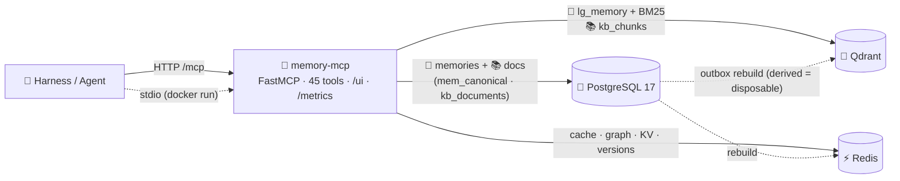
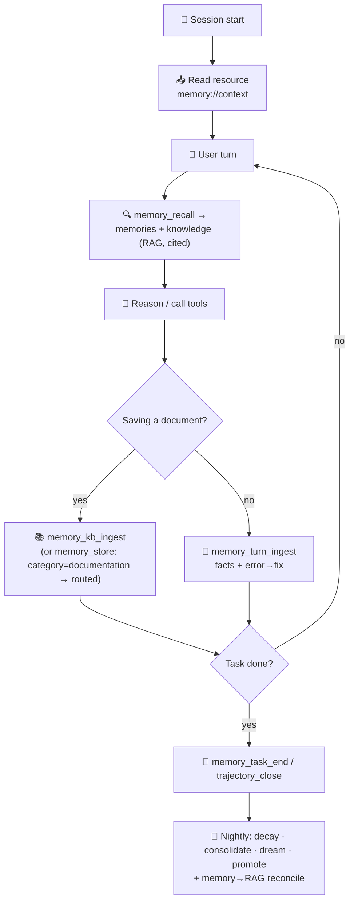
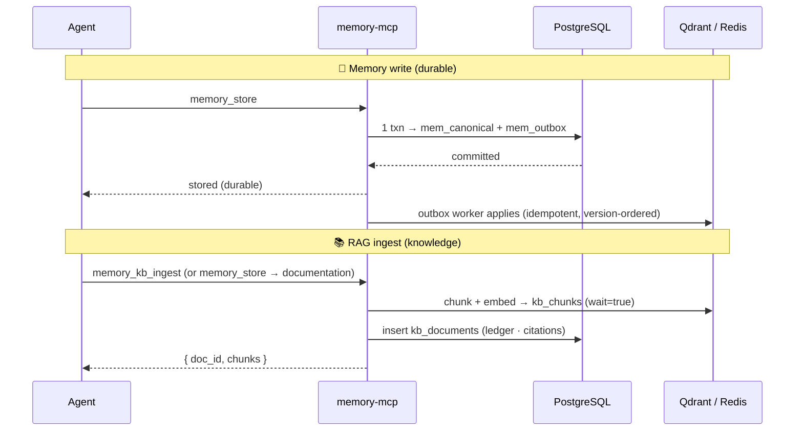
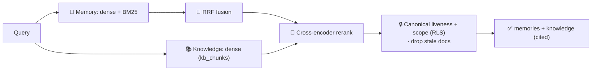
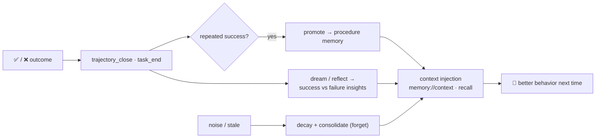
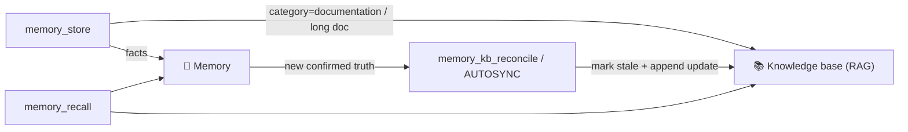

<div align="center">

# 🧠 ANY HARNESS MEMORY

### A self-contained, production-grade **memory + RAG** system for **any harness**

**PostgreSQL · Qdrant · Redis · MCP** — bi‑temporal, hybrid, durable, harness‑agnostic.


> 🧠 Long-term memory · 📚 Document knowledge base (RAG) · 🕰️ Bi-temporal · 🧬 Auto-learning · 🔌 MCP-native

</div>

---

## ✨ What is Memory?

**Memory** is a complete **memory + RAG** backend you run yourself. One `docker compose up`
gives an AI agent both a real long‑term memory **and a searchable knowledge base (RAG) over your documents** — in one stack: it **remembers**, **recalls**, **relates**,
**forgets what changed**, and **learns from outcomes** — across sessions, machines and
harnesses.

> Think of it as the *memory layer* under your agent: durable, searchable, temporal,
> and reachable over the **Model Context Protocol**.

| 🧩 Piece | 🗄️ Role | 💾 Persistence |
|---|---|---|
| **memory-mcp** | FastMCP server · dashboard · metrics | stateless (code in image) |
| **PostgreSQL 17** | Canonical **source of truth** + outbox · RAG **document ledger** (`kb_documents`) | `pgdata` volume |
| **Qdrant** | Vector store — memories (`lg_memory`) **+ RAG chunks (`kb_chunks`)** | `qdrantdata` volume |
| **Redis** | Short‑term KV, semantic cache, graph edges, versions | `redisdata` volume |

---

## 🏗️ Architecture



> **Nothing is exposed except `memory-mcp`**, bound to `127.0.0.1`. The three stores
> live on a private Docker network.

---

## 🔁 How it works — the workflow

### ① The agent loop (core‑injected memory)



Memory becomes a **reflex**, not a tool the model must remember to call: the harness
pulls `memory://context` at boot, recalls before answering, and captures after each turn.

### ② The write path (durable by design)



Postgres is the **only** source of truth. A crash between steps loses nothing — the
outbox replays. A corrupted vector index is **rebuilt from canonical**.

### ③ The read path (hybrid)



### ④ The long‑memory lifecycle

| Stage | What happens |
|---|---|
| **Decay** | Ebbinghaus half‑life (180 d) lowers stale importance |
| **Consolidate** | dedupe · merge · evict · archive |
| **Compact** | long trajectories summarised |
| **Dream** | success‑vs‑failure insight synthesis |
| **Promote** | repeated wins become procedure memories |

---

## 🕰️ Bi‑temporal (what was true, when)

Every memory carries `valid_from` / `valid_until` and an optional `event_time`.

- Supersession **keeps history** (never deletes the old version).
- `memory_recall(as_of=<ISO8601>)` → **point‑in‑time** answers.
- `memory_timeline` → full version/supersession chain + content previews.
- Graph edges carry validity windows and close when a fact is superseded.

```bash
memory_recall { "query": "deploy target", "as_of": "2026-03-01T00:00:00Z" }
memory_timeline { "memory_id": "..." }
```

---

## 🧬 Auto-Learning — no model training

**The model is never retrained.** Learning lives in the *memory substrate*: the system
captures outcomes, keeps what works, discards what doesn't, and injects the result as
context into every future turn — so the agent behaves better without touching the weights.



| Mechanism | What it learns |
|---|---|
| Outcome capture (`task_end`, `trajectory_close`) | which approaches succeed vs fail |
| **Promotion** | repeated wins become **procedure** memories |
| **Dream / reflection** | comparative insight from mixed trajectories |
| **Feedback loop** (`memory_feedback`) | re-ranks useful vs irrelevant memories |
| **Decay + consolidation** | forgets noise, keeps signal |
| **Self-editing core** (`memory_hint`, `core_update`) | the agent directs its own memory |

> Net effect: **continuous, non-parametric learning** — no fine-tuning, no retraining,
> no GPU. The "learner" is the evolving, curated memory that is injected into the prompt.

---

## 📚 RAG — knowledge base (documents)

Memory holds facts about the user/agent; **RAG holds your documents** — a separate lane on the same stack (its own Qdrant collection `kb_chunks` + a `kb_documents` ledger). Documents are **not** stored as memories, so decay/dedup/supersession never touch your files.

| Tool | Purpose |
|---|---|
| `memory_kb_ingest` | chunk + embed + store a document (idempotent per source) |
| `memory_kb_search` | retrieve top chunks with **citations** (`source#chunk`) |
| `memory_kb_sources` | list ingested documents |
| `memory_kb_delete` | delete a document by `doc_id` or `source` |
| `memory_kb_reconcile` | mark contradicting doc chunks **stale** + append an update chunk (memory → knowledge) |

```bash
memory_kb_ingest { "text": "...", "source": "runbook.md", "title": "Runbook" }
memory_kb_search { "query": "backup window", "top_k": 5 }
```

**Memory → knowledge reconciliation:** when a *confirmed* memory (importance ≥ `MEMORY_KB_SYNC_MIN_IMPORTANCE`) contradicts a document, `memory_kb_reconcile` (and, with `MEMORY_KB_AUTOSYNC=1`, the store path automatically) **marks the affected chunk `stale` (reversible — never deleted)** and appends an `update` chunk. `memory_kb_search` hides stale chunks by default (`include_stale` reveals them).

**Full interconnection:**
- **Docs route to RAG, not memory** — `memory_store` with `category:"documentation"` (or any long, structured document ≥ `MEMORY_DOC_ROUTE_CHARS`) is stored in the knowledge base and returns `routed_to:"rag"` (no `memory_id`).
- **Recall searches both lanes** — with `MEMORY_RECALL_INCLUDE_KB=1`, `memory_recall` returns a `knowledge` array (with citations) alongside `memories`, in one call.
- **Memory updates RAG** — `memory_kb_reconcile` / `MEMORY_KB_AUTOSYNC`.

Reuses the same embeddings, cross-encoder reranker, scope auth and durability — one stack, two lanes: **memory = what's true about you, RAG = what's true in your files.**

---

## 🔗 Two lanes, fully wired



> Save docs → they land in RAG. Recall → it checks both. New truth → RAG gets corrected.

---

## 🚀 Install

### Prerequisites

- 🐳 **Docker** + **Docker Compose v2**
- 💻 ~4 GB RAM free (models + stores)
- 🌐 Internet on first boot (downloads the embedding + reranker models)

### Steps

```bash
# 1) get the code
git clone https://github.com/Akshat-530/any-harness-memory.git
cd memory

# 2) configure
cp .env.example .env
#    edit MEMORY_PG_PASSWORD and MEMORY_REDIS_PASSWORD (and port if needed)

# 3) build & launch
docker compose up -d --build
```

> First boot bootstraps the schema from `schema.sql`, creates the Qdrant collection,
> and downloads the models into the `memdata` volume (one‑time).

### Verify

```bash
docker compose ps                         # all services "healthy"
curl -s http://127.0.0.1:4000/healthz     # -> ok
```

| What | URL |
|---|---|
| **MCP endpoint** | `http://127.0.0.1:4000/mcp` |
| **Dashboard** | `http://127.0.0.1:4000/ui` |
| **Metrics** | `http://127.0.0.1:4000/metrics` |
| **Liveness** | `http://127.0.0.1:4000/healthz` |

---

## 🔌 Connect any harness

The MCP endpoint is **streamable HTTP** at `http://127.0.0.1:4000/mcp`.
Ready‑to‑paste configs live in [`examples/`](examples/).

| 🤖 Harness | Transport | File |
|---|---|---|
| **Kilo / Kilo Desktop** | remote HTTP | `examples/kilo.jsonc` |
| **Cursor** | remote HTTP / bridge | `examples/cursor.mcp.json` |
| **Claude Desktop** | stdio bridge (`mcp-remote`) | `examples/claude_desktop_config.json` |
| **Cline / Continue** | remote or stdio | `examples/cline.json`, `examples/cline-stdio.json` |
| **LangChain / Python** | streamable HTTP | `examples/langchain.py` |
| **Any stdio‑only client** | stdio (Docker) | see below |

**stdio** (inherits backend env + network):

```bash
docker compose run --rm -T --entrypoint python memory-mcp /app/memory_server.py
```

Or bridge HTTP → stdio for desktop apps:

```bash
npx -y mcp-remote http://127.0.0.1:4000/mcp
```

### 🔐 Authentication

- **Dev / single‑user:** `MEMORY_ALLOW_ANONYMOUS=1` — callers are confined to an isolated namespace.
- **Production / multi‑user:** mount `auth_tokens`, set `MEMORY_ALLOW_ANONYMOUS=0`.
  Send **`Authorization: Bearer <token>`** or **`X-Memory-Token: <token>`**.
  Identity is resolved server‑side from the token; **Postgres RLS** enforces tenant isolation.

---

## ⚙️ Configuration

| Variable | Default | Meaning |
|---|---|---|
| `MEMORY_PG_USER` / `_PASSWORD` / `_DB` | `memory` / — / `memory` | Postgres |
| `MEMORY_REDIS_PASSWORD` | — | Redis AUTH (required) |
| `MEMORY_HTTP_PORT_HOST` | `4000` | Host loopback port |
| `MEMORY_TOOL_PROFILE` | `agent` | `agent` (~45 tools) or `full` (~79) |
| `VIRTUAL_CONTEXT_ENABLED` | `1` | Inject context blocks into recall/session responses |
| `MEMORY_MAINTENANCE` | `1` | Nightly consolidate / dream / decay / promote / backup |
| `MEMORY_EAGER_PREWARM` | `1` | Warm models + BM25 at boot |
| `MEMORY_JUDGE_ENDPOINT` / `_MODEL` / `_API_KEY` | blank | Optional OpenAI‑compatible LLM judge |
| `MEMORY_KB_AUTOSYNC` | `0` | Auto-reconcile memory→RAG on confirmed stores |
| `MEMORY_KB_SYNC_MIN_IMPORTANCE` | `7` | Min importance for a memory to update the knowledge base |
| `MEMORY_RECALL_INCLUDE_KB` | `0` | Recall also searches the knowledge base (returns a `knowledge` array) |
| `MEMORY_DOC_ROUTE_CHARS` | `2000` | Long structured content auto-routes to RAG |

---

## 🧰 Endpoints & tools

| Endpoint | Purpose |
|---|---|
| `POST /mcp` | MCP (streamable HTTP) |
| `GET /ui` | Dashboard — browse, edit, export |
| `GET /metrics` | Prometheus |
| `GET /healthz` | Liveness (no auth, no data) |

**MCP resources (zero‑call context):** `memory://context`, `memory://profile`, `memory://core`.

**Core tools:** `memory_store`, `memory_recall`, `memory_get`, `memory_list`, `memory_update`,
`memory_delete`, `memory_turn_ingest`, `memory_auto_observe`, `memory_session_init`,
`memory_task_end`, `memory_graph_link/neighbors/relations`, `memory_versions`,
`memory_version_restore`, `memory_timeline`, plus operator tools (consolidate, dream,
reflect, promote, eval, outbox, identity).

---

## 🧪 Benchmarks

Reproducible recall@k / MRR harness:

```bash
docker run --rm --network memory-mcp_memory --entrypoint python \
  -v "$PWD/benchmarks/memory_bench.py:/b.py:ro" memory:latest \
  /b.py --self-test --url http://memory-mcp:4000/mcp
```

For LoCoMo / LongMemEval / BEAM, see [`benchmarks/README.md`](benchmarks/README.md).

---

## 🔐 Security

- 🔒 Only `memory-mcp` is published, on `127.0.0.1`.
- 🧱 Postgres `scram-sha-256`, no host port; Redis `requirepass` + `protected-mode`.
- 🪪 Token → principal → per‑operation scope authorization → **row‑level security**.
- 🛡️ Poison guard (OWASP LLM04), secret/PII scanning, quarantine, audit log, GDPR export.
- 🚫 No secret is baked into the image; all credentials come from `.env`.

---

## 📈 Operations

```bash
docker compose ps
docker compose logs -f memory-mcp
docker compose exec postgres psql -U memory -d memory \
  -c "select status, count(*) from mem_canonical group by status;"
```

- **Backups:** `app/tools/memory_backup.py` (local + optional offsite).
- **Maintenance:** nightly cron (consolidate / dream / decay / promote / backup).
- **Eval gate:** `memory_eval_run` for regression checks.

---

## 📂 Project structure

```text
memory/
├─ compose.yml              # qdrant · redis · postgres · memory-mcp
├─ Dockerfile               # standalone image (python 3.12 + CPU torch)
├─ docker-entrypoint.sh     # wait-for-postgres → bootstrap schema → serve
├─ schema.sql               # authoritative PostgreSQL schema
├─ app/                     # memory_server.py (core) + memory_http_server.py (HTTP/UI)
│  ├─ tools/                # backup, maintenance, migrations helpers
│  └─ requirements*
├─ config/                  # postgresql.conf · pg_hba.conf · redis.conf · qdrant.yaml
├─ client/                  # harness client + memory protocol prompt
├─ examples/                # harness configs (Kilo · Cursor · Claude · Cline · LangChain)
├─ tests/                   # smoke · integration · stdio · temporal
├─ benchmarks/              # recall@k / MRR harness
└─ .github/workflows/ci.yml
```

---

## 🩺 Troubleshooting

| Symptom | Fix |
|---|---|
| `port is already allocated` | change `MEMORY_HTTP_PORT_HOST` in `.env` |
| `401 Unauthorized` | send `Authorization: Bearer` or `X-Memory-Token`; check `auth_tokens` |
| First request slow | models are warming; set `MEMORY_EAGER_PREWARM=1` |
| `health: starting` for a while | model download on first boot — wait or watch `docker compose logs -f` |
| Recall empty right after store | derived index applies via outbox; `MEMORY_OUTBOX_SYNC_GRACE_SECONDS` tightens it |

---

## 📜 License

**MIT** © 2026 Akshat — see [LICENSE](LICENSE).

<div align="center">

**Built to remember. Designed not to forget what mattered.**

⭐ Star the repo if ANY HARNESS MEMORY powers your agents.

</div>